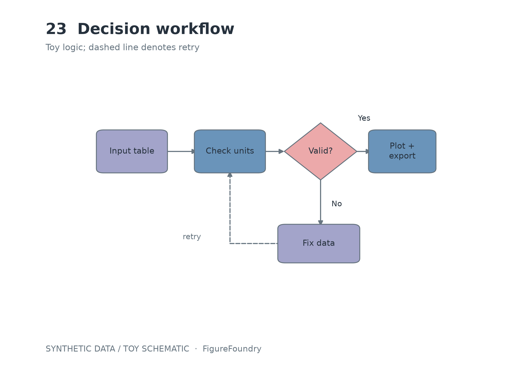
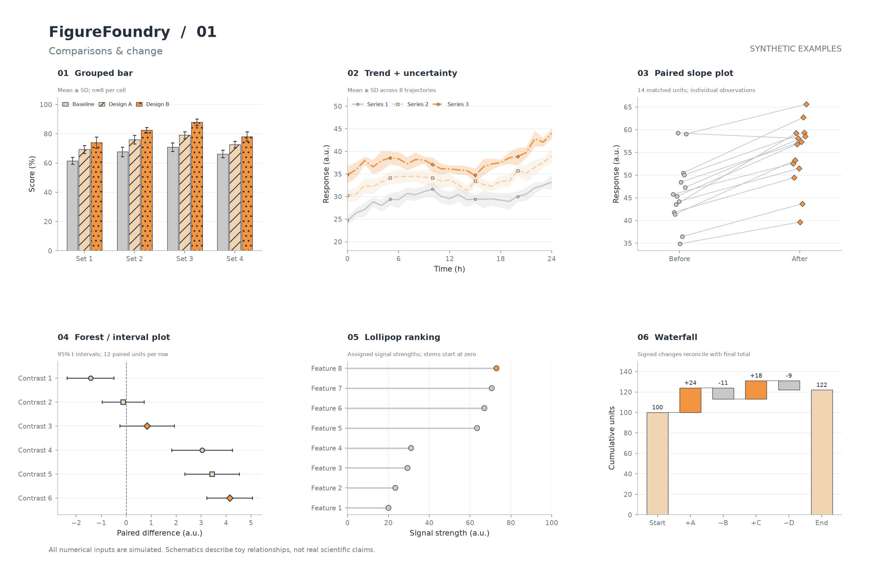
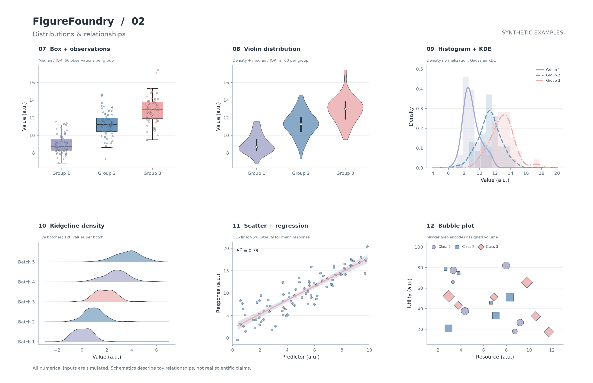
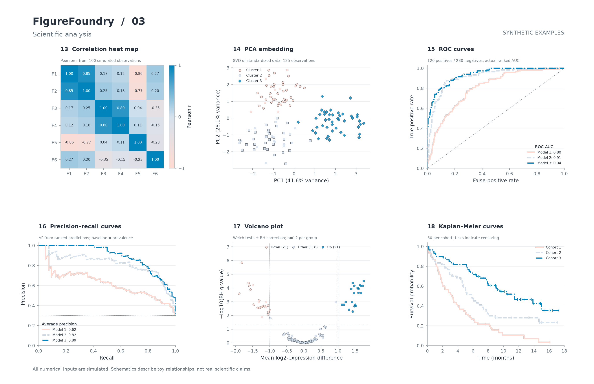
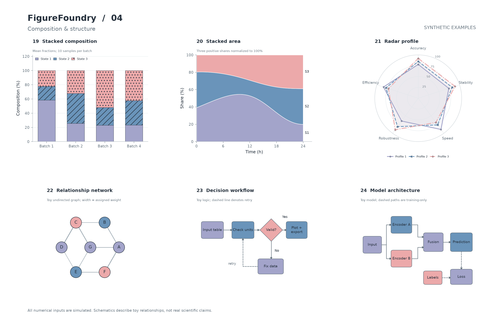
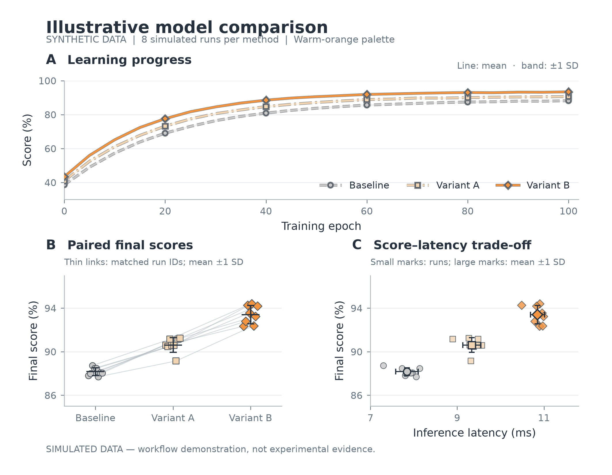

# FigureFoundry · 图件工坊

**从源数据和方法关系，画到可编辑、可复跑的科研图件。**

[English](README.md) · [简体中文](README.zh-CN.md) · [24种图型画廊](gallery/GALLERY.md) · [下载技能包](figure-foundry-skill.zip)

FigureFoundry 是经过筛选、改写和重新组合形成的科研绘图 skill。本项目借鉴 [Diagram Design](https://github.com/cathrynlavery/diagram-design)、[AgentFigureGallery](https://github.com/Dsadd4/AgentFigureGallery) 和 [Open Research Skills](https://github.com/gxCaesar/open-research-skills) 的实践经验，将数据图与方法示意图整合成一套流程，并加入统一的分流规则、三组配色、导出帮助脚本和可检查的示例。

**明确问题 → 根据来源设计 → 构建可编辑图件 → 查看真实渲染 → 核对并交付。**

## 本 skill 的整合改进

| 设计选择 | FigureFoundry 的做法 | 实际价值 |
|---|---|---|
| 数据图、示意图双路线 | 数值走数据绘图；架构、机制、流程走可编辑示意图。 | 统计曲线与流程连线分别遵循适合自身含义的规则。 |
| 一次brief、一套检查循环 | 复用已经知道的偏好，合并重复的风格询问、布局与质量检查。 | 普通任务可以直接推进，无需重复品牌设定或强制图库投票。 |
| 按任务选择输出 | 数据图同源导出PNG/SVG/PDF；示意图保留矢量对象，其它格式按需求选择。 | 同时服务论文插图和后续修改。 |
| 三组稳定配色 | 保留准确色值，必要时加入形状、线型、纹理和中性描边。 | 浅色仍可读，类别也能通过第二种视觉通道区分。 |
| 数据与统计可追溯 | 读取已保存输入，明确独立单位和误差含义，保留生成器与绘图代码。 | 可以复跑，也能检查数值怎样变成图上的点、线和区间。 |
| 检查真实导出结果 | 打开实际文件，核对布局和统计，修改已发现的问题，记录验证范围。 | 质量说明有可查看的图片和检查结果支持。 |
| 安装轻量 | 技能主体共10个文件，原仓库和大型图库为可选资源。 | 使用整合后的流程，不必同时安装三套skill系统。 |

这些改进针对选中来源中的具体流程。原步骤如何取舍、重复与冲突如何处理，见[合并决策表](skill/figure-foundry/references/sources-and-decisions.md)。

## 实际画出的流程图

下面是之前生成的判断流程图，输入来自已保存的虚构关系。实线表示正向流程，虚线表示输入未通过检查后返回修改。



[可编辑SVG](gallery/figures/23_flowchart.svg) · [PDF](gallery/figures/23_flowchart.pdf) · [模型架构示例](gallery/figures/24_architecture.png) · [绘图代码](gallery/render_gallery.py) · [输入数据](gallery/synthetic_data.json)

## 24种图型，配源码、数据和自检

所有数值均为**固定随机种子生成的合成数据**；网络、流程与架构使用虚构关系。每张单图均提供PNG、SVG、PDF。

| 类别 | 图型 |
|---|---|
| 比较与变化 | 分组柱状、趋势误差带、配对斜率、森林区间、棒棒糖排序、瀑布图 |
| 分布与关系 | 箱线、小提琴、直方/KDE、山脊密度、回归散点、气泡图 |
| 科研分析 | 相关热图、PCA、ROC、PR、火山图、Kaplan–Meier生存曲线 |
| 组成与结构 | 堆叠柱状、堆叠面积、雷达、关系网络、判断流程、模型架构 |

[查看完整图文画廊](gallery/GALLERY.md) · [英文画廊](gallery/README.md) · [下载图件、源码、数据和技能](figure-foundry-gallery.zip)

[离线HTML画廊](gallery/index.html)提供筛选、搜索和放大。GitHub上请先查看图文画廊；下载项目后，在本机打开HTML使用浏览功能。

<details>
<summary>展开查看四组、共24张图</summary>









</details>

最初的三面板示例也保留了[CSV数据](demo/synthetic_data.csv)、[生成器](demo/generate_data.py)、[绘图源码](demo/plot_demo.py)、[图注](demo/caption.zh-CN.md)和[统计摘要](demo/plot_checks.json)。



## 安装与调用

### 直接让编程助手安装

在 **Codex** 中向内置安装器发送：

```text
$skill-installer 安装以下地址中的技能：
https://github.com/jiangyuhan0318-July/figure-foundry/tree/main/skill/figure-foundry
```

在 **Claude Code** 中发送：

```text
从 https://github.com/jiangyuhan0318-July/figure-foundry 安装FigureFoundry。
将完整的skill/figure-foundry目录复制到~/.claude/skills/figure-foundry，
包含参考文件、配色、脚本和许可文件。安装后确认/figure-foundry可用。
```

技能子目录URL明确指出仓库中可以安装的部分。下载需要联网，安装需要本地文件写入权限；公开仓库可不登录GitHub直接下载。

### 手动安装

克隆仓库，或下载并解压[技能ZIP](figure-foundry-skill.zip)。复制完整的`figure-foundry`目录，一起保留参考、配色、帮助脚本和许可。

| 客户端 | 个人安装目录 | 仅当前项目 | 调用方式 |
|---|---|---|---|
| Codex | `~/.agents/skills/figure-foundry/` | `.agents/skills/figure-foundry/` | `$figure-foundry` |
| Claude Code | `~/.claude/skills/figure-foundry/` | `.claude/skills/figure-foundry/` | `/figure-foundry` |

上表依据当前[Codex官方文档](https://learn.chatgpt.com/docs/build-skills)和[Claude Code官方文档](https://code.claude.com/docs/en/skills)。Codex内置安装器会使用其配置的技能目录；部分安装环境使用`~/.codex/skills/`。

首次安装到个人目录，先执行：

```bash
git clone https://github.com/jiangyuhan0318-July/figure-foundry.git
cd figure-foundry
```

**macOS/Linux shell：**选择客户端目录，再复制。

```bash
skill_root="$HOME/.agents/skills"  # Codex；Claude Code改为"$HOME/.claude/skills"
mkdir -p "$skill_root"
cp -R skill/figure-foundry "$skill_root/"
```

**Windows PowerShell：**

```powershell
$skillRoot = Join-Path $HOME '.agents\skills'  # Codex；Claude Code改为'.claude\skills'
New-Item -ItemType Directory -Force -Path $skillRoot | Out-Null
Copy-Item -LiteralPath .\skill\figure-foundry -Destination $skillRoot -Recurse
```

在目标项目中新开会话，使用表中的对应命令。仅当前项目使用时，复制到该项目内的对应目录即可。

Codex调用示例：

```text
$figure-foundry 用暖橙组绘制这个CSV。
展示独立观测，注明误差条含义，查看实际渲染，
交付绘图源码和SVG/PDF。
```

Claude Code调用示例：

```text
/figure-foundry 把这段方法画成可编辑SVG。
保留输入分支，用不同线型区分训练专用连接。
```

安装技能会复制流程与资源，Python依赖需要单独安装。Matplotlib路线使用包含`matplotlib`、`numpy`、`scipy`的Python环境。完整复跑示例及检查使用Python 3.12+和[requirements.txt](requirements.txt)，已在空Python 3.13虚拟环境中验证。Origin可按实际编辑需求接入，当前示例未调用Origin或原生PPTX路线。

## 复跑

已使用Python 3.13和[requirements.txt](requirements.txt)记录的包版本运行。在仓库根目录执行：

```bash
python -m pip install -r requirements.txt
python demo/generate_data.py
python demo/plot_demo.py --skill-dir skill/figure-foundry
python gallery/generate_data.py
python gallery/render_gallery.py --skill-dir skill/figure-foundry
python gallery/build_index.py
python gallery/verify_gallery.py
```

生成器先保存输入，绘图脚本再读取。三面板示例种子为`20261026`，24图画廊种子为`261026`。

## 自检结果

- 24张单图和4张合集，共84个PNG/SVG/PDF已打开检查，尺寸符合设定。
- 画廊SVG保留原生文字与矢量对象，热图色块也已矢量化，无内嵌位图。
- ROC AUC/AP与PCA结果和scikit-learn一致；BH校正和SciPy一致；另外核对组成总和、瀑布图终值和生存风险集乘积。
- 实际查看四张合集，修正已发现的标签、图例、连线和矢量导出问题。
- 技能格式校验通过，本机安装版与便携副本逐文件一致。

详细记录：[画廊自检](gallery/verification.json)、[自检脚本](gallery/verify_gallery.py)、[打包检查](verification.json)、[使用过程与自检说明](使用说明与自检.md)。

上述结果覆盖已记录的示例；尚未进行与来源skill的绘图质量或速度对照实验。原生PPTX/draw.io/Origin未实跑。HTML静态链接已检查，内置浏览器阻止本地文件协议，因此浏览交互未实测。Kaplan–Meier帮助函数目前展示的是事件时间不重复的合成输入。

## 三组保存配色

| 配色 | 准确色值与顺序 |
|---|---|
| 暖橙组 | `#C8C8C8` · `#F1D5B3` · `#F29440` |
| 紫蓝粉组 | `#A3A4CA` · `#6A94BA` · `#ECA9AA` |
| 浅肤蓝组 | `#FFDBD1` · `#D6E2EE` · `#0183BB` |

配色存放在[palettes.json](skill/figure-foundry/assets/palettes.json)。帮助脚本使用局部样式上下文，同一绘图场景导出多种格式。

## 来源与许可

本项目借鉴了以下三个来源的实践经验：

- [Diagram Design](https://github.com/cathrynlavery/diagram-design)：视觉层次、语义关系、连线和布局检查；MIT。
- [AgentFigureGallery](https://github.com/Dsadd4/AgentFigureGallery)：实际查看参考图、稳定的类别与风格偏好；MIT。
- [Open Research Skills — build-scientific-visualizations](https://github.com/gxCaesar/open-research-skills/tree/c79bac60f882b626e1754bff95101441e165e4ec/skills/build-scientific-visualizations)：源数据、独立单位、整图设计、可编辑交付和渲染检查；Apache-2.0。

本项目筛选、改写并重新组织这些经验，形成新的skill。来源固定提交、选择标准和冲突处理见[决策记录](skill/figure-foundry/references/sources-and-decisions.md)及[带日期的仓库快照](audit/repository-snapshot.json)。

新增代码与整合部分采用[Apache-2.0](LICENSE)，原始MIT声明保留在[LICENSES](LICENSES)，归属见[NOTICE](NOTICE)。本项目公开的图件与数据均为合成示例，未打包第三方参考图库或论文数据。
